# Uncharted Leaders & Civs

Shuffle or build abilities, uniques & starts.

A Civilization VII mod that shuffles what leaders and civilizations bring to a game. Leaders can swap whole
abilities, swap whole leaders, or have their abilities broken into single bonuses and dealt out at random. Civilizations
can do the same with their abilities, attribute tags, unique units and civics, within each age. Any part can be taken
out of the game for everyone. The game's own screens show what each leader and civilization ended up with.

Status: 1.0.0, unreleased. Checked offline with lint and tests on the Antiquity, Exploration and Modern databases; much
of it has been seen in lab games (devtools/probes/RESULTS-*.md), and what still has to be seen is on the workspace
[WATCH_LIST.md](../../WATCH_LIST.md). It ships single-player only: multiplayer hasn't been tested, and the
first release says so.

## What it does

- **Uncharted Leaders & Civs Settings** in Advanced Settings: a Mode that sets the three leader rows (abilities,
  attributes, start terrain), three civilization rows (abilities, uniques, civics), AI agendas, Human players keep
  their own leader, Keep my built civilization and Reveal who got what, then buttons for the leader list, leaders
  from other mods, the Leader pool, the Civilization pool, AI players, the two build screens and Advanced settings
  (Split fairness and the shuffle number). The rows share their words: Base game, Swap whole, Split up, Follows
  ability, Logical with bonuses, Random roll, Off entirely. The settings save with the game.
- **Pools and AI players.** The pools narrow who Random can pick, with a button beside Random on the leader and
  civilization select. AI players gives each AI a Leader and a Civilization dropdown.
- **Build your own leader and Build your own civilization**, card screens for your own leader and civilization. The
  cards you leave are shuffled among the AI players. When a card goes with another, a button adds the other one.
- **Things that need each other stay together**: a quarter's two civics, the great people a quarter brings, the Sherpa
  and its power station, Sengoku's Samurai and Kinsei, Carthage's second Colonist with the Colonist, the Pirate
  Republic's "no Settlers" with the Buccaneer, and the rules the game keeps on an ability for one of its uniques
  ([docs/DEPENDENCIES.md](docs/DEPENDENCIES.md)).
- **Civilization attribute tags** (Cultural, Economic and the rest) go with the ability, so the attribute quests and
  Test of Time traditions follow it.
- The deal runs in SQL each time the game loads, gated on the setup values, so it comes out the same after a load, in
  each age and on each machine. The setup screen works out the same deal in JS to show it before the game starts.
- The leader select, civilization select, loading screen, diplomacy leader panel (with Who got what), Civilopedia and
  City Details show the result.

## Descriptions for release

[docs/steam-workshop-description.txt](docs/steam-workshop-description.txt) is the player-facing description, in Steam
BBCode. `node scripts/build-descriptions.mjs` writes the CivFanatics (`docs/civfanatics-description.txt`), ModDB
(`docs/moddb-description.txt`) and GitHub release (`docs/github-release.md`, title in `docs/github-release-title.txt`)
versions from it. `--check` says whether they've fallen behind and holds each text to its platform's limit: 8000 bytes
for Steam (with curly quotes only, so `steamcmd` can carry it), 100 characters for the CivFanatics tagline, 1000 for
the ModDB summary. The tagline and the short ModDB description are written by hand from the same text. None of it has
been pushed anywhere.

The icon is [docs/workshop-preview.svg](docs/workshop-preview.svg): three cards dealt in a fan (a crown for leaders, a
banner for civilizations, a mountain for start terrain) in the Tower mods' hex tile. `scripts/build-preview.sh`
renders it to the 1024x1024 `docs/workshop-preview.png` used on Steam, CivFanatics, ModDB and the GitHub release.
Steam doesn't take the preview through `steamcmd` for this account, so it goes up by hand on the Workshop page.

## Screenshots

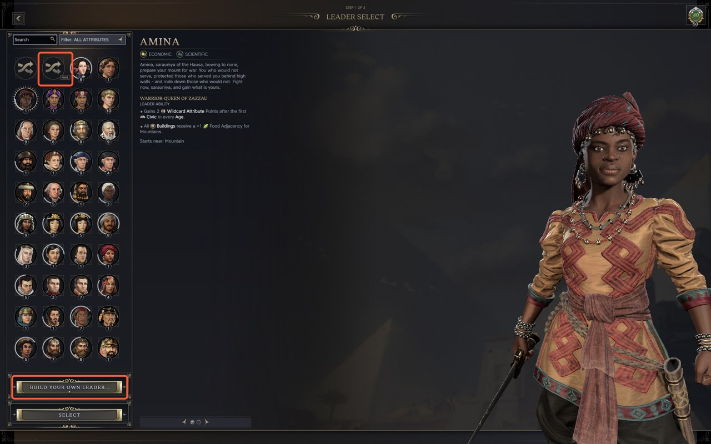
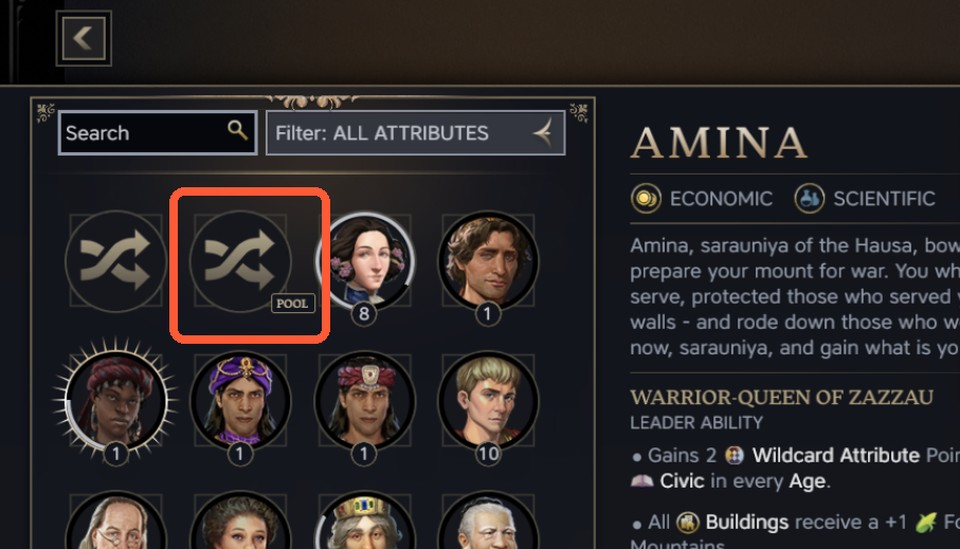
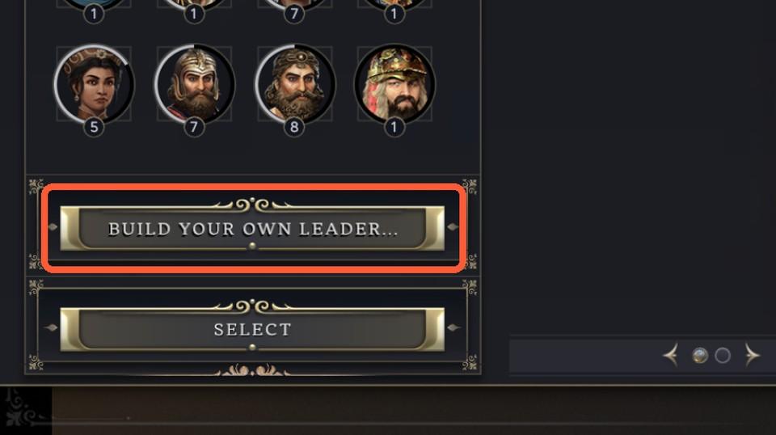
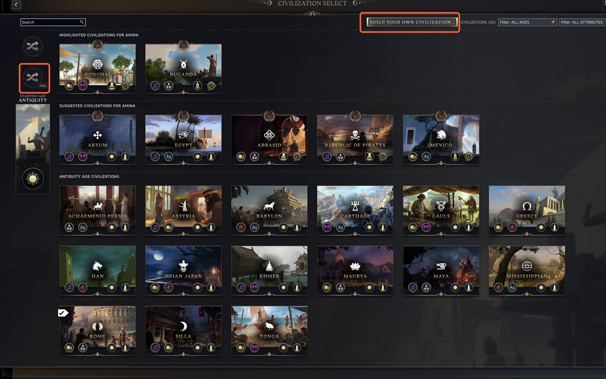
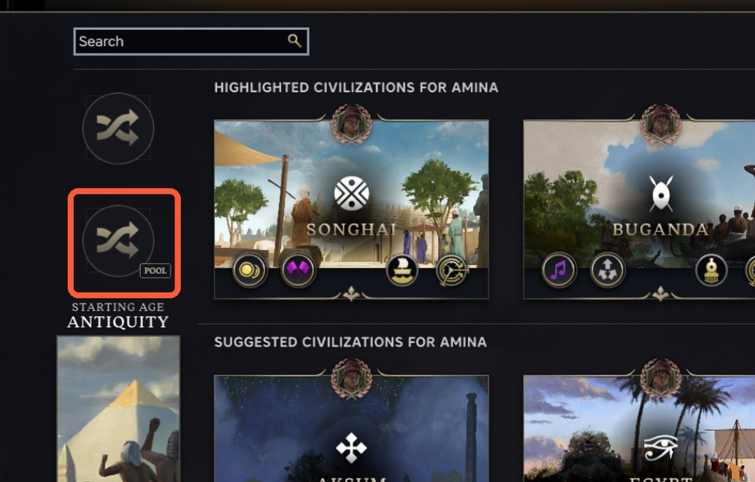
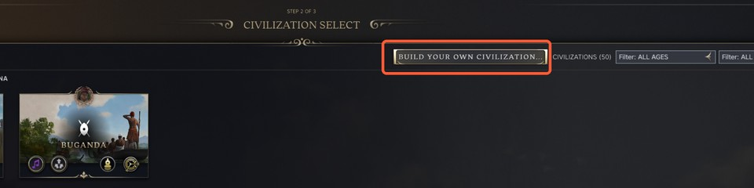
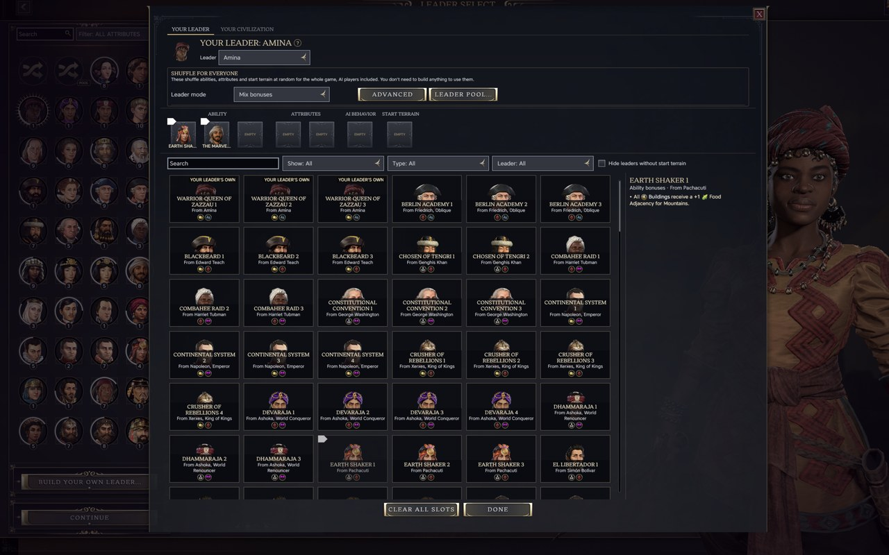
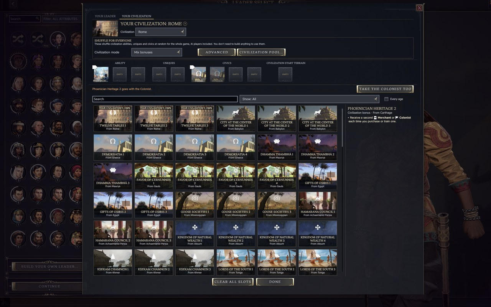
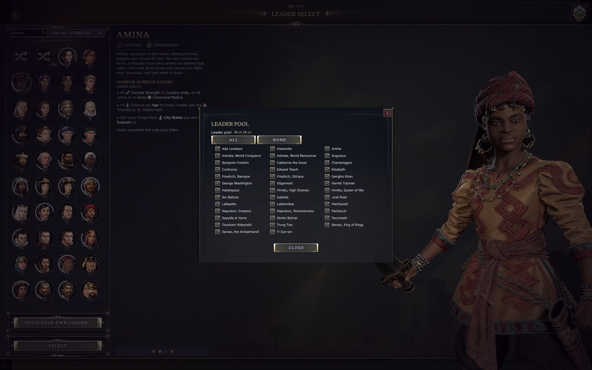
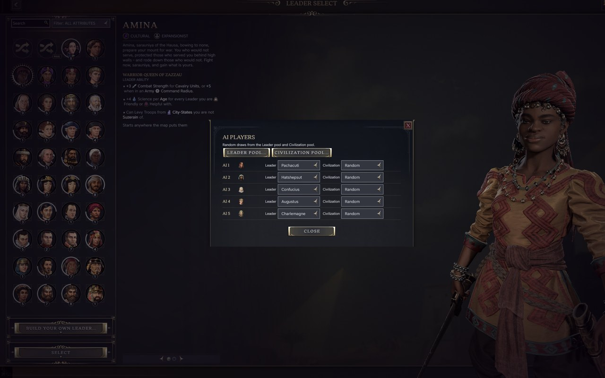
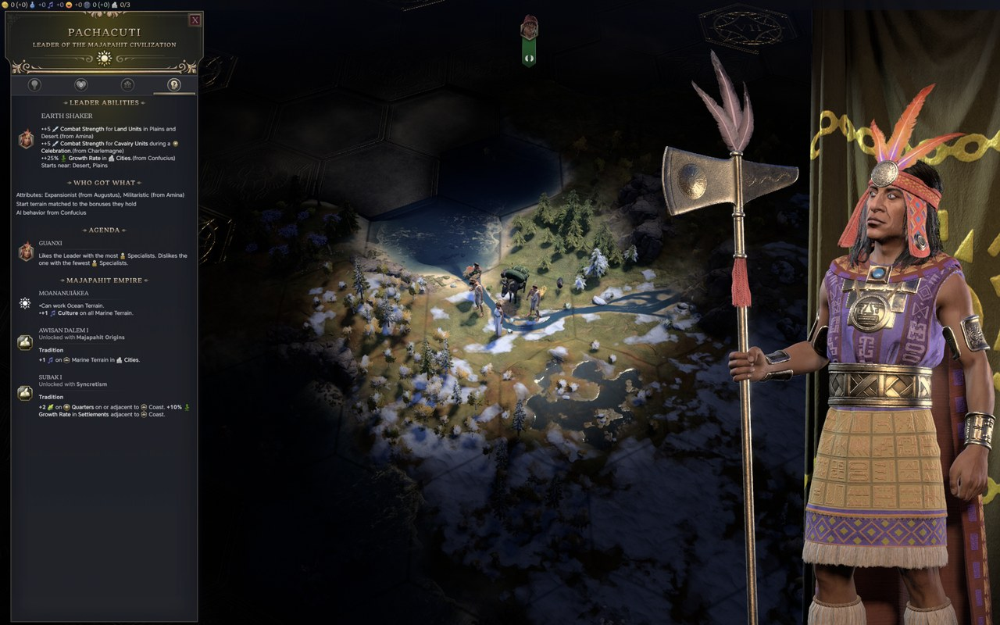

`docs/screenshots/` (1280x800, for here and the GitHub release) and `docs/steam-screenshots/` (1920x1200, for the
Workshop page) are built by `python3 -I scripts/build-screenshots.py <raw folder>` from window captures of a lab game
with every other mod off. The script cuts the title bar, trims to 16:10 and writes JPEGs with no EXIF, XMP, colour
profile or date; `--check` confirms it. Its CROPS list adds the close-ups (03, 04, 06, 07). The boxes around the new
buttons on 02 and 05 are drawn on copies of those two captures; the plain captures are kept in the raw folder's
`original/`.

## How it's laid out

[CONTRACTS.md](CONTRACTS.md) is the build's source of names: setup parameters, config keys, tables, text keys, the
modinfo groups and who owns which folder. [docs/SPEC.md](docs/SPEC.md) is the design, and CONTRACTS.md section 12 says
where the build departs from it.

| Path | Holds |
| --- | --- |
| `shared/` | Names, the deal key, bullet splitting, the known leaders, and `shared/deal/lshuf-deal.js`, the deal itself in plain JS |
| `scripts/generate/` | Turns the deal into the gameplay SQL in `data/generated/` |
| `scripts/mapping/`, `data/mapping/` | The bullet-to-modifier mapping for each ability |
| `scripts/setup-copy/`, `data/setup-copy/` | The setup-side copy of the game rows the deal reads before a game exists |
| `data/schema/`, `data/frontend/` | The mod's tables and the setup parameters |
| `data/text-generated/` | Each ability bullet's text in all the game's languages, split from the game's own text |
| `ui/setup/` | The setup window, the leader pools and the start-of-game config writes |
| `ui/display/`, `ui/game/` | The leader screens, Who got what in the leader panel, the loading screen and City Details |
| `text/` | English text; [text/TRANSLATION.md](text/TRANSLATION.md) lists what the other languages need |
| `tests/` | Tests, including the check that the SQL and the JS give the same deal |
| `docs/` | The spec, the compatibility audit, the modded leader list and ideas parked for later |
| `devtools/` | The lab probes behind the design and the modded leader scan |

## Running the checks

From this folder, after `npm install`:

```sh
npm run lint            # ESLint over ui, shared, scripts and tests
npm run check           # node --check on each JS file
npm test                # runs tests/run-all.mjs
npm run build:modinfo   # builds the .modinfo from modinfo.template.xml and the generated groups
npm run verify          # check, lint and test in one go
```

The tests build their databases from `tests/fixtures/source-db/` (not committed): copy a gameplay, frontend and
localization `-copy.sqlite` set there from an in-game Debug folder with the Tower mods on. Without it they read the
live Debug folder, which a launch that stops at the main menu leaves nearly empty. The Exploration and Modern
databases come from `tests/fixtures/source-db/exploration/` and `modern/`: the same three files from a game started in
that age with the other mods off.

These all run offline. Anything in a running game (lab games, deploys, logs) goes through Tower Bench, as the
workspace rules say.
