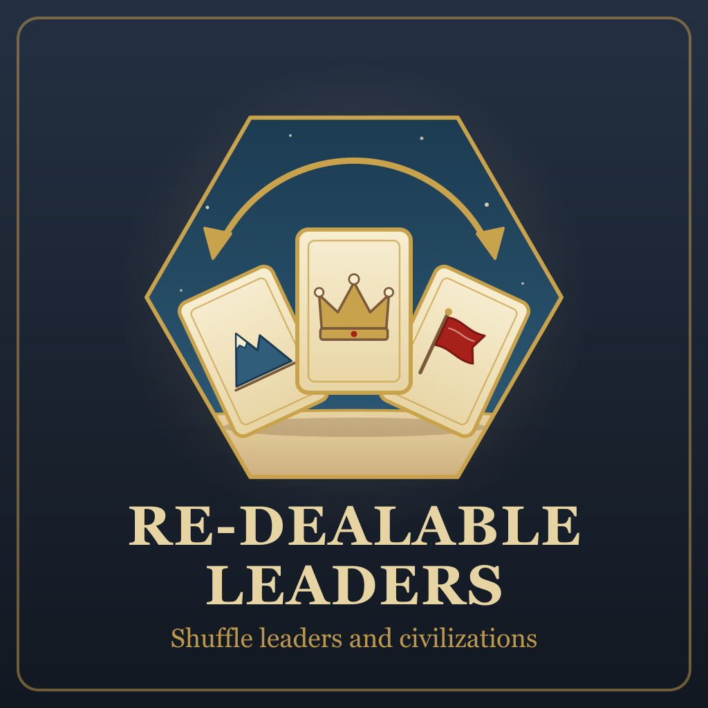

**Version 1.0.4. Compatible with Civilization VII 1.5.1. Single-player only.**

Shuffle what leaders and civilizations bring to a game. Leaders can swap whole abilities, swap whole leaders, or have their abilities broken into single bonuses and dealt out at random. Civilizations can do the same with their abilities, unique units and civics, within each age. You can also take any part out of the game for everyone. The game's own screens show what each leader and civilization ended up with.

Civilization IV had a Random Personalities option that handed the AI leaders each other's personalities. You couldn't tell how a leader would behave from who they were, and the games were more interesting for it. This mod started from that option. My own way to play is to change only a few of these parts from the game setup menu and leave the rest as the game made them, instead of building my own leaders and civilizations. The option to customize everything and fully randomize it was too good to pass up, so that's in here too.

## Where to find it
In New Game, open Advanced Settings and expand **Uncharted Leaders & Civs Settings**. The settings save with the game like any other setup option.

## Two questions
The section asks how the AI players are shuffled and how you are, and the line under each dropdown says what the pick does.
- **AI players' leaders** and **AI players' civilizations:** Play as normal, Trade places (everything from one other leader or civilization), Mixed swap (an ability from one, the rest from others), Mix bonuses (single bonuses from several, with starts that suit them) and, for leaders, Mix bonuses with a random start, New personalities and New personalities and attributes.
- **Your leader** and **Your civilization:** Shuffled like the AI players, or one of the same choices for you alone.
- **Leader personalities:** As the game made them, Follow their bonuses (each AI plays like the leader its bonuses came from) or Shuffled (personalities dealt out apart from the bonuses).

## Part by part
Advanced settings... has a row for each part, and changing one makes the mode read Custom. The choices are Base game, Swap whole, Split up, Follows ability, Logical with bonuses, Random roll and Off entirely, and each row offers the ones that fit it. With Split up, everyone gets back as many pieces as they gave.
- **Leader abilities:** Base game, Swap whole, Split up or Off entirely.
- **Leader attributes:** Base game, Split up, Follows ability or Off entirely.
- **Leader start terrain:** Base game, Logical with bonuses, Follows ability, Random roll or Off entirely. Civilizations' start terrain is shuffled within each age to match.
- **Civilization abilities:** Base game, Swap whole, Split up or Off entirely. A civilization's attribute tags (Cultural, Economic and the rest) go with its ability. When abilities are split up, the tags are shuffled. The age's attribute quests and Test of Time traditions follow the tags.
- **Civilization uniques:** Base game, Follows ability, Swap whole, Split up or Off entirely.
- **Civilization civics:** Base game, Follows ability, Swap whole, Split up or Off entirely. Civics bring their traditions and the buildings, quarters and improvements they unlock.

Civilizations only swap with civilizations from the same age.

## What travels together
Things that need each other stay together: a quarter's two buildings, the great people a quarter brings (the Logios with the Acropolis, the Conquistador with the Plaza and five more), the Sherpa and the Highland Power Station, and Sengoku's Samurai and the Kinsei civic. When the game keeps a unique's rule on its civilization's ability, such as the Conquistador crossing Ocean, the rule goes with the unique. Carthage's second Merchant or Colonist goes with the Colonist, and the Pirate Republic's “no Settlers” goes with the Buccaneer and its settling charge. Yi Sun-sin's Fleet Commander bonuses stay together, and whoever holds Ibn Battuta's Wildcard bonus gets his Wildcard points. Every civilization bonus can be dealt. A “+30% Production towards <wonder>” bonus names its wonder for whoever holds it, and Assyria’s “Codices are not awarded from Technologies” goes to whoever holds it. The Inca’s and Songhai’s treasure convoys come with their civics, and their cards say so.

## Off entirely
Off entirely takes that part out of the game for everyone. With leader abilities off, each AI keeps its own personality. With attributes off, everyone gets the twelve diplomatic actions instead. With start terrain off, the map alone decides where everyone starts. Leaders and civilizations built by hand keep their picks.

## Reveal who got what
From the start, or once you've met a leader.

## Pools and AI players
- **Leader pool** and **Civilization pool:** tick the leaders and civilizations Random can pick. Each also has a button beside Random on its select screen.
- **AI players:** a Leader and a Civilization dropdown for each AI player, left on Random or set by hand.
- **Choose which leaders are shuffled:** unticked leaders play as normal.

## Build your own
Build your own leader and Build your own civilization are card screens. Fill your slots from another leader's bonuses or whole ability, attributes, AI behavior and start terrain, or another civilization's ability or bonuses, uniques, civics and start terrain. Tick Every age to take a civilization's ability or start terrain from another age. Cards you build stay yours, whatever the modes say. When a card goes with another, a button adds the other one. The civilization select between ages has the same Build your own civilization button.

## Advanced settings
- **Split fairness:** Fair shares gives everyone about the same strength. With Pure luck some leaders end up stronger.
- **Shuffle number:** the same number with the same settings and leaders gives the same shuffle. It shows on the loading screen so you can share it.

## What you see
A leader's shuffled ability, attributes and start terrain show on the leader select, the loading screen, the diplomacy leader panel and the Civilopedia, with a “Starts near:” line for start terrain. A civilization's dealt ability, uniques, civics and tags show on the civilization select and the loading screen. The leader panel's Who got what says which leader each bonus came from. City Details names the percentage bonuses the game lists as “Other”.

## Single-player only
This release is for single-player games. Multiplayer hasn't been tested yet.

## Other mods and maps
- When another mod changes a base-game leader or civilization, the shuffle carries that change.
- 25 leader mods (27 leaders) built the way the base game's leaders are can join the shuffle through Leaders from other mods, after a check of the mod's files at setup. Other modded leaders play as their mod made them.
- With Drongo's Syncretism Revealer on, its start terrain panel is hidden while start terrain is shuffled.
- Maps that place starts themselves (the Earth maps, YnAMP and other true-start-location maps) ignore start terrain. Abilities and attributes still shuffle.

## Limits
English only for now. The Civilization pool only applies at the start of the game. When this mod updates, a campaign keeps the shuffle it started with; if a fix has to change it, a notice on the next turn says so.
